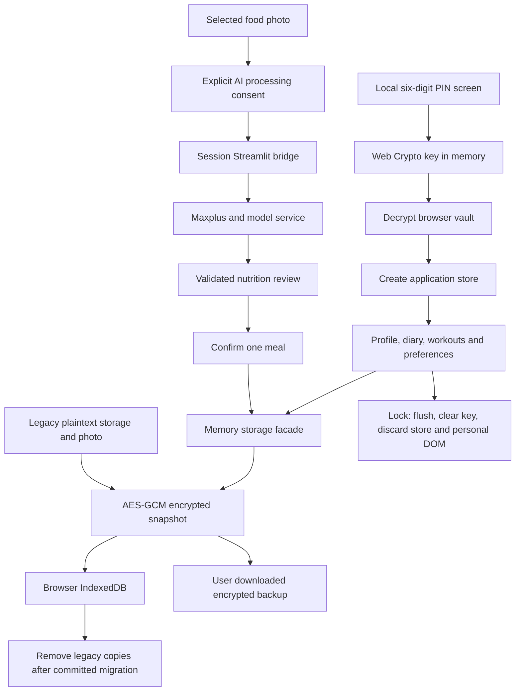

# Fitness-app privacy audit — 2026-10-09

Scope: `66050275-pun/fitness-app` only. Public Streamlit mobile preview, its frontend source, persistent data pipeline and Capacitor wrapper configuration. This is an implementation review and regression check, not an independent penetration test or a legal compliance certification.

## Application and data flow

NutriAI is a TypeScript/Vite nutrition and fitness tracker with a Capacitor Android wrapper. Streamlit builds the frontend and keeps the existing HTML/JavaScript/CSS in its original srcdoc iframe, alongside an invisible session-scoped API component. Profile, goals, diary, workouts and the vault PIN stay in the client. With configured Maxplus owner credentials, Python processes explicitly consented food photos and an optional service access code in session memory, then returns validated nutrition for local review. It does not store these photos or receive the vault decryption key.

There is no application user database, account login, connected health provider or remote coach. The scanner calls Maxplus through Python only when the owner's key and image-capable model are configured and the user confirms photo processing. Manual entry remains available. The coach remains a local demonstration. Clipboard copy and sharing are explicit user actions; feedback copy can include the email and description the user entered.

## Persistent information

| Data | Before | Now |
| --- | --- | --- |
| Lock-screen language choice (`en` / `th` only) | Not previously available | Non-sensitive `nutriai_ui_language` localStorage flag |
| Name, birth date or entered age, sex, height, current/target weight, fitness objective, weight goal, activity level | Plaintext localStorage | Encrypted vault |
| Onboarding answers and draft, nutrition targets, eating schedule, preferences, consent | Plaintext localStorage | Encrypted vault |
| Meal diary, custom foods, portions, water and burned calories by date | Plaintext localStorage | Encrypted vault |
| Workout history, weekly routines, scheduled workouts, records derived from history | Plaintext localStorage | Encrypted vault |
| Weight history, search history, dashboard layout and insight range | Plaintext localStorage | Encrypted vault |
| Feedback subject, description, contact email and diagnostics preference | Plaintext localStorage | Encrypted vault |
| Profile photo | Plaintext Blob in separate IndexedDB | Encrypted bytes in same vault |
| Food scan photo | Local preview only | Ephemeral browser/Streamlit session memory; sent to Maxplus/model service only for confirmed AI analysis; not included in app snapshots/backups |
| Maxplus owner API key | Not configured | Streamlit Secrets or server environment only; omitted from public component config, browser storage and provider errors |
| Coach conversation, active workout and unsaved modal/form input | In memory | In memory; discarded on lock |
| Downloaded backup | Plaintext JSON, omitted photo | Encrypted JSON, includes photo and saved drafts |

Only seven explicitly named legacy NutriAI localStorage keys and `nutriai_profile_db` are migrated/removed. Unrelated browser storage is not cleared. Backups already downloaded under an older version are outside the application's control and may still contain plaintext.

## Protection implemented

- Web Crypto AES-256-GCM with a fresh random 96-bit IV per snapshot and AAD `NutriAI private vault v1`. New six-digit PIN keys use PBKDF2-HMAC-SHA-256 with 800,000 iterations and a random 128-bit salt; keys are non-extractable and remain only in memory. Credential type and bounded KDF iterations are preserved in snapshots and encrypted backups. Original v1 passphrase vaults omit this metadata and retain their 600,000-iteration derivation until migration.
- Failed authentication is tracked in non-sensitive IndexedDB metadata: three consecutive failures cause a 30-second delay; five cause a five-minute lockout. Successful authentication resets the counter. An atomic transaction reserves each attempt across tabs; abandoned attempts expire after two minutes and count as failures. PINs are never written into metadata.
- A synchronous memory facade preserves existing state APIs; serialized asynchronous commits write only ciphertext. Storage success is reported after IndexedDB transaction completion. There is no plaintext fallback.
- Migration commits ciphertext before removing the legacy data and photo. A failed migration remains recoverable; existing encrypted records are never replaced by creating a new vault.
- Atomic comparison of the previous record during write prevents stale tabs from silently overwriting each other. Conflicts display a save error. The losing tab can export its current in-memory data as an encrypted backup even if saving failed; it must not blindly overwrite the other tab.
- Wrong PINs/passphrases and authentication failures leave encrypted data untouched; only the attempt metadata changes. Locks wait for pending writes; failed writes leave a protected recovery screen instead of pretending the lock completed.
- Manual lock and five-minute inactivity lock discard the application store, revoke the profile object URL, stop workout timers, clear personal DOM and remove the in-memory key reference. Backgrounding immediately covers the screen; elapsed time is checked again on return because background timers can be throttled.
- User text is HTML escaped. Dynamic string arguments in inline event handlers are JSON encoded and then HTML escaped, including names/IDs containing quotes. Coach messages, meal labels, confirmation messages, legacy dates, photo URLs and custom food descriptions were covered.
- Google-hosted fonts and Unsplash demo images were replaced with bundled fonts and a local illustration. Production iframe CSP permits only the Open Food Facts JSON search endpoint for connections; it blocks other fetch/WebSocket destinations, frames, workers, form submissions and external image/font sources. Existing template event handlers still require `unsafe-inline`; this policy is a supplementary protection, not a replacement for escaping or a guarantee against hostile application code.
- Privacy/FAQ/coach text now distinguishes local demos, encrypted local records, public source code, network metadata and the limits of unlocked-device protection.

## Practical limits

- Browser data is scoped to an origin and browser profile. It does not synchronize between devices and may be lost when browser storage is cleared/evicted, private browsing ends, or the app URL changes. Keep a backup and its original credential separately; backups exported before PIN migration still require the original passphrase.
- There is no PIN recovery. A six-digit PIN has only one million possibilities and provides less resistance to offline guessing than a strong passphrase. PBKDF2 increases the cost per guess. Client-side lockouts can be bypassed by editing local metadata or guessing against copied ciphertext; they do not provide server-enforced protection.
- The app and same-origin scripts can read decrypted information while unlocked. Device compromise, extensions, malicious updates and people using the unlocked browser are outside at-rest encryption's protection.
- Streamlit's surrounding page and the host still handle normal network requests and metadata. The inner iframe CSP does not control hosting-page analytics or provider logging.
- Browser persistence and mobile lifecycle behavior vary. The automated browser checks below use Chromium with a mobile viewport; physical iPhone/Android browsers and a built Android APK were not independently validated.
- The PIN remains associated with the empty encrypted vault after “Delete All Local Data.” Downloaded backups and old exported files are not erased by deletion inside the app.
- Standard JavaScript cannot promise immediate zeroization of garbage-collected memory or prevention of screenshots. Locking removes live application references and personal DOM; it is not full-device security.

## Original verification (2026-10-09)

- TypeScript type check and Vite production build.
- Existing header, planner and onboarding regressions updated for the private storage facade and safe handler arguments.
- Vault regression: locked access, minimum passphrase, migration with failed quota before commit, unrelated storage preservation, photo migration, ciphertext secrecy, fresh IVs, wrong password, tampering, stale tab conflict, quota failure, recovery export/restore, retry, deletion and reload.
- Chromium mobile viewport: migrate synthetic profile/feedback; no plaintext remnants; render every main screen and profile subpage; malicious coach/feedback text does not execute; manual and inactivity lock; incorrect/correct password; reload returns to lock screen; no external requests from the tested frontend flows.
- Actual Streamlit-generated srcdoc iframe: encrypted storage creation and lock/unlock operate inside the iframe; the Python wrapper completes without app exceptions.
- npm production dependency audit: no reported vulnerabilities at review time. Full development audit retains seven findings in Tailwind 3's build-time brace/selector parser chain; fixing those requires a separate Tailwind major-version migration. Builds here consume trusted repository source. No claim is made that all dependency or future security risks have been eliminated.

## Component inventory

The table below lists every screen/component source and its input controls. All persistent writes go through the store/private storage pipeline above; render-only modules do not independently send data to a server.

| Component | Role / controls |
| --- | --- |
| `src/components/BottomSheets/QuickAddBottomSheet.ts` | `renderQuickAddBottomSheet`; renders navigation, records, summaries or actions |
| `src/components/PhasicTools/HiddenFatScanner.ts` | Food scan/review entry, today's scanned nutrition, and a clearly labeled missing-fat calculator; `phasic-fat-oil`, `phasic-fat-coconut`, `phasic-fat-dressing`, `phasic-fat-meal` |
| `src/components/PhasicTools/ProteinSplitter.ts` | Saved four/five interval choice and rounded target allocation |
| `src/components/PhasicTools/ProteinRadar.ts` | Today’s known meal-group protein chart and incomplete-data states |
| `src/components/PhasicTools/FatGauge.ts` | Known logged fat and weight-based ceiling, including uncertainty |
| `src/components/PhasicTools/PhaseCycleTracker.ts` | Cycle calendar and refeed allowances; `phasic-cycle-start`, `phasic-cycle-weeks`, `phasic-cycle-refeed` |
| `src/components/PhasicTools/RecompMatrix.ts` | Paired seven-day weight and supported workout strength summaries |
| `src/components/PhasicTools/PhasicRecompTools.ts` | Built-in tool dispatcher inside the shared dialog lifecycle |
| `src/components/Fitness/MonthlyFitnessCalendar.ts` | `renderMonthlyFitnessCalendar`; renders navigation, records, summaries or actions |
| `src/components/Fitness/PlannerDateDetailModal.ts` | `renderPlannerDateDetailModal`; renders navigation, records, summaries or actions |
| `src/components/Fitness/TodaysWorkoutCard.ts` | `renderTodaysWorkoutCard`; renders navigation, records, summaries or actions |
| `src/components/Fitness/WeeklyProgramEditorModal.ts` | `renderWeeklyProgramEditorModal`; renders navigation, records, summaries or actions |
| `src/components/Modals/CustomFoodModal.ts` | `renderCustomFoodModal`; fields: `cf-name`, `cf-brand`, `cf-category`, `cf-barcode`, `cf-serving-desc`, `cf-serving-qty`, `cf-serving-unit`, `cf-serving-equiv`, `cf-serving-desc-opt`, `cf-protein`, `cf-carbs`, `cf-fat`, `cf-calories`, `cf-fiber`, `cf-sugar`, `cf-sodium`, `cf-vit-c`, `cf-vit-d`, `cf-calcium`, `cf-iron`, `cf-potassium`, `cf-magnesium`, `cf-new-portion-qty`, `cf-new-portion-unit`, `cf-new-portion-equiv` |
| `src/components/Modals/DeleteWorkoutModal.ts` | `renderDeleteWorkoutModal`; renders navigation, records, summaries or actions |
| `src/components/Modals/DiaryCalendarModal.ts` | `renderDiaryCalendarModal`; renders navigation, records, summaries or actions |
| `src/components/Modals/MealDetailModal.ts` | `renderMealDetailModal`; renders navigation, records, summaries or actions |
| `src/components/Modals/NutrientDetailModal.ts` | `renderNutrientDetailModal`; fields: `nutrient-modal-search` |
| `src/components/Modals/ProfileConfirmationModal.ts` | `renderProfileConfirmationModal`; fields: `confirm-typing-input` |
| `src/components/Modals/QuickActionModal.ts` | `renderQuickActionModal`; renders navigation, records, summaries or actions |
| `src/components/Modals/SetPortionModal.ts` | `renderSetPortionModal`; fields: `set-portion-qty-input`, `set-portion-unit-select`, `set-portion-date`, `set-portion-time` |
| `src/components/Modals/WeightEntryModal.ts` | `renderWeightEntryModal`; fields: `weight-entry-id`, `weight-input-value`, `weight-input-unit`, `weight-input-date`, `weight-input-time`, `weight-input-note` |
| `src/components/Navigation/AppHeader.ts` | `renderAppHeader`; renders navigation, records, summaries or actions |
| `src/components/Navigation/BottomNav.ts` | `renderBottomNav`; renders navigation, records, summaries or actions |
| `src/components/Nutrition/CalorieProgressRing.ts` | `renderCalorieProgressRing`; renders navigation, records, summaries or actions |
| `src/components/Profile/ProfileMenuRow.ts` | `renderProfileMenuRow`; renders navigation, records, summaries or actions |
| `src/components/Profile/ProfileMenuSection.ts` | `renderProfileMenuSection`; renders navigation, records, summaries or actions |
| `src/screens/AICoachScreen.ts` | `renderAICoachScreen`; fields: `chat-input` |
| `src/screens/DashboardScreen.ts` | `renderDashboardScreen`; renders navigation, records, summaries or actions |
| `src/screens/DiaryScreen.ts` | `renderDiaryScreen`; renders navigation, records, summaries or actions |
| `src/screens/FitnessScreen.ts` | `renderFitnessScreen`; renders navigation, records, summaries or actions |
| `src/screens/FoodResultScreen.ts` | `renderFoodResultScreen`; renders navigation, records, summaries or actions |
| `src/screens/FoodSearchScreen.ts` | `renderFoodSearchScreen`, `renderFoodDefinitionCard`; fields: `food-search-input` |
| `src/screens/InsightsScreen.ts` | `renderInsightsScreen`; renders navigation, records, summaries or actions |
| `src/screens/PersonalRecordDetailScreen.ts` | `renderPersonalRecordDetailScreen`; renders navigation, records, summaries or actions |
| `src/screens/ProfileScreen.ts` | `renderProfileScreen`; fields: `profile-photo-input` |
| `src/screens/QuickLogScreen.ts` | `renderQuickLogScreen`; fields: `ql-food-name`, `ql-quantity`, `ql-unit`, `ql-serving`, `ql-save-to-my-foods`, `ql-calories`, `ql-protein`, `ql-carbs`, `ql-fat`, `ql-date`, `ql-time` |
| `src/screens/ScannerScreen.ts` | `renderScannerScreen`; renders navigation, records, summaries or actions |
| `src/screens/WorkoutDetailScreen.ts` | `renderWorkoutDetailScreen`; renders navigation, records, summaries or actions |
| `src/screens/onboarding/OnboardingScreen.ts` | `getOnboardingGoalPreview`, `renderOnboardingScreen`; bundled introduction plus four-step wizard; fields: `onboarding-name`, `onboarding-age`, `onboarding-height-cm`, `onboarding-current-weight`, `onboarding-target-weight`, `onboarding-calories`; sex radio group `onboarding-sex`; six objective/four activity selection cards |
| `src/screens/profile/ActivityLevelScreen.ts` | `renderActivityLevelScreen`; renders navigation, records, summaries or actions |
| `src/screens/profile/AppSettingsScreen.ts` | `renderAppSettingsScreen`; fields: `app-language-select` |
| `src/screens/profile/DataPrivacyScreen.ts` | `renderDataPrivacyScreen`; renders navigation, records, summaries or actions |
| `src/screens/profile/EatingScheduleScreen.ts` | `renderEatingScheduleScreen`; fields: `eating-schedule-enabled`, `schedule-start-time`, `schedule-end-time` |
| `src/screens/profile/FeedbackScreen.ts` | `renderFeedbackScreen`; fields: `feedback-category-input`, `feedback-subject-input`, `feedback-description-input`, `feedback-email-input`, `feedback-diagnostics-input` |
| `src/screens/profile/HealthConnectionsScreen.ts` | `renderHealthConnectionsScreen`; renders navigation, records, summaries or actions |
| `src/screens/profile/HelpCenterScreen.ts` | `renderHelpCenterScreen`; fields: `faq-search-input` |
| `src/screens/profile/LegalDocumentScreen.ts` | `renderLegalDocumentScreen`; renders navigation, records, summaries or actions |
| `src/screens/profile/MarketingConsentScreen.ts` | `renderMarketingConsentScreen`; renders navigation, records, summaries or actions |
| `src/screens/profile/NutritionGoalsScreen.ts` | `renderNutritionGoalsScreen`; fields: `goal-calorie-input`, `goal-protein-input`, `goal-carbs-input`, `goal-fat-input`, `goal-water-input` |
| `src/screens/profile/PersonalInformationScreen.ts` | `renderPersonalInformationScreen`; fields: `profile-name-input`, `profile-dob-input`, `profile-height-cm`, `profile-height-ft`, `profile-height-in`, `profile-weight-input` |
| `src/screens/profile/WeightGoalScreen.ts` | `renderWeightGoalScreen`; fields: `weight-goal-type-input`, `weight-target-input`, `weight-target-date-input`, `weekly-rate-input` |
| `src/screens/profile/WeightHistoryScreen.ts` | `renderWeightHistoryScreen`; renders navigation, records, summaries or actions |
| `src/screens/profile/WhatsNewScreen.ts` | `renderWhatsNewScreen`; renders navigation, records, summaries or actions |

### State, services and calculations

| Module | Responsibility |
| --- | --- |
| `src/main.ts` | Screen routing, form capture, validation and explicit clipboard/download actions; starts the store only after unlock |
| `src/store/appState.ts` | Application state, persisted fields, durable onboarding completion/retry, workout timers and store disposal |
| `src/components/PhasicTools/phasicToolController.ts` | Validates active/unlocked tool actions, captures unsaved controls without persistent drafts, refreshes local day views and clears timers on disposal |
| `src/services/phasicRecompService.ts` | Pure preset, split, radar, gauge, calendar and matched trend calculations; no network or storage calls |
| `src/screens/onboarding/onboardingController.ts` | Captures and validates draft inputs, updates review feedback without replacing focused controls, coordinates async completion and blocks actions during vault locking |
| `src/utils/onboardingGoals.ts` | Shared objective/activity definitions, metric validation and local calorie/macro/hydration preview; no network or independent storage writes |
| `src/services/nutritionPlanService.ts` | Six pure Mini Cut/Lean Bulk planning functions; validates calorie/macro feasibility and returns targets, duration metadata or a weight-trend recommendation without network/storage writes |
| `src/security/vaultUI.ts` | Create/unlock screen, save indicator, lock, background shield, recovery and backup restore |
| `src/services/privateStorage.ts` | Encryption, migration, transaction commit, concurrency, encrypted backup/restore |
| `src/services/storagePersistence.ts` | Versioned app schema, legacy migration and field sanitizers |
| `src/utils/profileImageStorage.ts` | File type/size validation, crop/compress to JPEG and encrypted photo persistence |
| `src/services/aiFoodAnalysisAdapter.ts` | Pure future response adapter; no network request |
| `src/utils/sanitize.ts` | HTML escaping and inline handler argument encoding |
| Other `src/utils/*Calculations.ts`, `dateUtils.ts`, `unitConversions.ts`, `safeNumbers.ts` | Local calculations, portions, units, dates and bounds; no network/storage layer |
| `src/data/*` | Bundled catalog, presets, references, demo data and explanatory text |
| `index.html`, `src/index.css`, `vite.config.ts` | UI shell, locally bundled styles/fonts and production network restrictions |
| `streamlit_app.py` | Build and inline static frontend only; no personal input widgets or user-data storage |
| `capacitor.config.ts`, `android/` | Native wrapper scaffold; HTTPS local scheme, Internet permission, no application backend configured |

### Exercise illustration update — 2026-10-10

`src/components/Fitness/ExerciseIllustration.ts` and `src/data/exerciseArtwork.ts` now render 52 locally bundled frames for 27 exercise names (26 distinct illustrations), covering all presets and catalog entries. The CC BY-SA 4.0 source credits and license are preserved under `docs/exercise-art/`. The setup, catalog and active session render data URLs, including in the Streamlit srcdoc iframe, without new external image requests. A browser review decoded all frames in all four presets and all ten catalog thumbnails, checked active-session images, and found no page errors or external requests. This adds a pinned asset package and approximately 1.7 MB to the uncompressed JavaScript bundle; initial loading on slow connections may take longer.

### 2026-10-10 — Workout muscle overview

Added `WorkoutMuscleMap` to workout setup, with original inline front/back SVG and a static exercise-to-muscle mapping. Highlights derive only from the local draft exercise names and update with additions/removals. No remote assets, API requests, analytics, or new storage are introduced. All dynamic exercise names are HTML escaped, including unknown-name notices. Red denotes listed movers/assistants, not measured activation or intensity; the UI explains the schematic limitation.

### 2026-10-10 — Navigation transitions and shared theme

- Added `ScreenTransitions` to coordinate navigation without retaining outgoing DOM or taking view-transition screenshots. Cached current-view markup, animations and navigation/scroll history are cleared on successful vault lock before the private screen is removed.
- Vault gate/status/shield and fitness artwork/muscle map now share light/dark design variables. Shield activation and lock content clearing remain immediate; encryption and storage behavior are unchanged.
- Back navigation returns workout detail views to Fitness, and supports setup/session back actions using the existing cancellation flow. Unsaved workout summaries remain until the explicit Save/Discard action.
- App and device Reduce Motion preferences disable page and CSS animations. Zoom, keyboard focus indicators, safe-area spacing and active-navigation semantics are supported.
- Verification: TypeScript/Vite production build; existing two Playwright privacy scenarios (mobile and actual Streamlit srcdoc); direct mobile/iframe checks of forward/back transitions, onboarding, hardware back, theme consistency, open-details preservation, reduced motion and lock/unlock. Only synthetic data was used. No external dependencies or new personal-data requests were added.

### 2026-10-10 — Consistent English and Thai

- Enabled both language choices and synchronized the interface, HTML language, encrypted app preference and passphrase-screen choice. Bundled translations cover navigation, onboarding, profile pages, food and nutrient views, fitness and muscle maps, dialogs, errors, dates and canned demo replies.
- User-entered text stays intact; canonical exercise IDs, food IDs, date keys, units used for calculations and stored numerical values are unchanged. Built-in food labels are translated only at display/search boundaries. There is no translation API or new personal-data network request.
- Only the non-sensitive two-value language flag is readable before unlocking. Private data remain encrypted. Unsaved-change protection checks the save-status enum, independently of displayed language. Language selection is disabled during vault opening, and status refreshes retain recovery controls.
- Verification: TypeScript/Vite production build; 121 mobile views/states across both languages; 16 checks in the actual Streamlit srcdoc, including language selection, red muscle highlights, lock/reload, localized password errors, safely escaped unchanged user text and the plaintext language flag. The frontend made no external requests and logged no runtime errors in these checks. Only synthetic data was used.

- Streamlit now fingerprints frontend sources (including translation JSON) and dependency files. Changed sources rebuild once, and the HTML cache uses the same signature so a previous language bundle is not reused. Unchanged dependencies and builds remain cached.

## Thai food search and workout assistant — 2026-10-10

- The six bundled Thai dishes use the supplied recipe estimates, labelled as estimates rather than verified Mahidol or Open Food Facts records. Portions scale by gram weight. No recipe database or user data is sent to the Streamlit server.
- Open Food Facts searches run only after the visible Search online action. The JSON request sends the search text and fixed public product filters, omits credentials and referrer, and loads no remote images. Open Food Facts receives the request and network address. CSP allows only https://world.openfoodfacts.org/cgi/search.pl for this feature.
- Queries and unsaved results remain in memory. Navigation, query changes and locking cancel outstanding requests; disposed stores cannot apply late results. Logging a community product retains its definition and source attribution in the existing encrypted browser vault for recents/reload.
- Weight recommendations derive locally from completed sets and saved workout history. Automatic fills preserve manual and completed set entries, and each suggestion is shown in the workout and rest clock. Stable rep brackets are stored with saved exercises; suggestion wording and undo snapshots stay in session memory and are discarded on lock.
- Build verification is recorded separately from the earlier regression results above. No new test suite or live Open Food Facts API verification was run for this addition.
## Special Program menu addition (2026-10-12)

- The saved `dietProgram` lives in the existing encrypted user profile. The
  unlock boolean is derived from that choice; legacy/unknown values load as
  standard. Goal edits remain in memory until Save.
- Menu view, tool selection, callback registrations and goal drafts use memory
  only. The six tools are explicitly labeled previews unless a developer
  registers their callbacks. This menu adds no network destination or scan.
- Vault locking cancels pending sheet actions synchronously before awaiting
  storage flush. It blocks new delayed dismiss actions during that flush and
  clears registered tool closures on deactivation. Failed-save recovery retains
  the mounted dialog and private store.
- Validation for this addition uses the production build and local synthetic
  mobile previews. No automated tests were added or run for this change.

## Six-digit PIN refactor

- Strict numeric six-digit validation applies to both create and unlock APIs, preserving leading zeros. The new keypad submits at six digits, confirms new PINs twice, clears buffers on errors/disposal and supports physical keyboards, optional haptics, English/Thai, light/dark themes and reduced motion.
- Existing passphrase vaults and encrypted archives migrate through a dedicated API: decrypt with the original credential, derive a new PIN key with a fresh salt, and replace the ciphertext only after an atomic comparison and durable commit. A failure before commit preserves the original record. Backups exported earlier are not rewritten.
- Storage/KDF failures and malformed decrypted payloads do not increment authentication failures. Concurrent attempts and completion tokens are checked with the current encrypted revision; successful authentication resets the counter. Local metadata contains only the salt identifier, attempt count, cooldown deadline and a temporary attempt lease.
- Validation for this change: TypeScript strict mode and Vite production build. No new or existing automated tests were run for this refactor; the original verification section above describes the earlier passphrase implementation.

## Introduction, onboarding and special nutrition plans — 2026-10-12

- Introduction step 0 uses bundled SVG artwork and leads to four setup steps. Fresh setup and restarted setup begin there; Back from the objective step returns to it. The wizard collects one of six objectives, optional display name, sex, age, metric body measurements and activity tier, then calculates targets locally. Drafts, final profile, goals and completion metadata use the existing encrypted snapshot; no new external service or personal-data request is introduced.
- Age is stored explicitly when no matching birth date exists. The flow does not infer a birthday or substitute a male/female equation for Other. That selection requires a manual calorie target; macros and hydration still derive locally from the supplied values.
- Mini Cut and Lean Bulk are real saved goal choices. Final confirmation aligns `primaryObjective` with `dietProgram`; choosing either unlocks the existing Special Program menu. A draft choice does not unlock it. The six extension actions remain previews unless connected through their callbacks; saving a nutrition plan does not implement scanning or phase/cycle tracking.
- `NutritionPlanService` exposes `calculateMiniCutCalories`, `calculateMiniCutMacros`, `getMiniCutPlanDetails`, `calculateLeanBulkCalories`, `calculateLeanBulkMacros` and `adjustLeanBulkCalorieSurplus`. Mini Cut uses a 25% deficit with configured 1,200 kcal female / 1,500 kcal male-or-Other floors, 2.3 g/kg protein and 0.65 g/kg fat with a 35 g minimum. These floors are planning defaults, not a guarantee of suitability. Lean Bulk onboarding defaults to the intermediate +220 kcal surplus; the service also supports beginner +300 and advanced +150, with 1.9 g/kg protein and approximately 25% fat calories. Remaining calories supply carbohydrates; an infeasible protein/fat budget is rejected.
- Hydration is 38 ml/kg for Mini Cut, 35 ml/kg for Lean Bulk and 32.5 ml/kg for standard goals, rounded to 50 ml. Mini Cut details provide a 4-week recommendation, 6-week maximum and optional maintenance day every 7 days. These are local plan metadata, not an automatically running phase schedule. Accepting a special-program Activity Level calorie suggestion recalculates macros and water with calories before saving through the same encrypted pipeline.
- The Lean Bulk adjustment function returns +120/−120 kcal suggestions outside the inclusive 0.25–0.5% bodyweight/week gain range and leaves in-range targets unchanged. It is pure: no automatic weight-diary reads, target changes or weight-entry writes occur. Applying its recommendation remains an explicit caller action, and reductions observe the app's 800 kcal input bound.
- UI previews and final store validation share the same calculation. Get Started waits for the encrypted write to commit before Dashboard navigation. Failed saves retain the review for retry; a stable completion identifier prevents duplicate initial weight entries. In-flight UI callbacks are blocked or invalidated when vault locking starts.
- Restarting setup preserves the confirmed profile, nutrition goals and histories until confirmation. Returning users can cancel the draft; first-time users must finish setup. Version-2 four-step drafts and older six-step drafts retain their valid resume position under flow version 3, returning to an earlier step when required answers are missing. Existing completed users remain completed.
- This entry documents source behavior. It makes no additional claim about automated tests, physical-device verification or independent security testing.

## Functional Phasic Recomp tools — 2026-10-12

- All six extension cards now open built-in centered dialogs with local calculations. The earlier preview descriptions above refer to their initial release. No image upload, remote scan, analytics endpoint or external chart library is added.
- Cooking-fat estimates are explicitly added as normal diary records, tagged with validated preset counts. Fat and its calorie energy are counted once; removing a tagged entry uses the diary deletion pipeline. Unknown nutrient snapshots stay unknown in the radar and fat gauge.
- Schema 8 stores protein interval count and a bounded phase schedule in the existing encrypted snapshot. Inputs, counts, date keys and phase identifiers are sanitized. A changed saved program clears an incompatible cycle. Refeed dates alter calorie/carbohydrate allowances, not consumed food or saved baseline goals; no background write is needed at midnight.
- Mutation controls verify the unlocked vault, saved Special Program and active tool. Accepted diary drafts reset to prevent accidental duplicate additions; later storage failures use the existing vault save indicator and retry flow. Private callbacks, chart views and dialog snapshots clear on lock/disposal.
- Protein uses a planning benchmark rather than a measured leucine threshold. Recomposition uses daily mean weights and matched supported exercise estimates, with explicit insufficient-data states; it does not infer body fat or lean mass.
- Validation for this update consists of strict TypeScript/Vite build, source review and passive synthetic mobile layouts. No automated tests were added or run.

## Food photo review update — 2026-10-12

Schema 9 stores optional original/reviewed scan analysis metadata in the same encrypted meal snapshot. The Hidden Fat scan flow treats cooking fat as part of total meal fat and adjusts only differences when a known estimate changes. It never creates a second fat entry for a reviewed scan.

Selected photos are prepared locally, retained in memory, and released on scan exit or vault lock. Their bytes, filenames, object URLs, upload consent and unfinished review drafts are excluded from vault persistence and backups. Recognition remains disconnected by default. A future trusted transport must supply a localized photo-processing notice and use a server that holds provider credentials; explicit consent precedes invocation. Cancellation/timeout ignores late responses, while any future server/provider retention must be agreed separately. Details: `docs/FOOD_SCAN_BACKEND.md`.

Additional modules: `src/services/foodAnalysisBackend.ts`, `foodPhotoService.ts`, `foodScanService.ts`, and `src/screens/foodScanController.ts`. The response adapter now validates unknown JSON, retains unknown nutrients/confidence, and renders only supplied micronutrients. Saved analysis preserves the original portion and nutrition, the included cooking-fat amount and edited-field provenance.

## Maxplus server integration — 2026-10-13

Adapted the official-host Bearer/chat-completion method and session bridge pattern from `66050275-pun/subject-ai` commit `96f83e50c93887cb9075bf28ae1077ef49893b58`, with read-only access to that repo. The owner selected Streamlit Secrets for the provider key. Live provider/vision compatibility has not been confirmed; no credentials or paid calls were used during implementation.

- A small handshaking component runs alongside the original app iframe. Sibling messages are bound to their source, origin and frame, with the Streamlit parent's origin captured from its own render event. Server requests/results are scoped to `st.session_state`; IDs deduplicate reruns, cancellation precedes new submissions, acknowledged uploads/responses leave wrapper queues, and late results from another frame are ignored. Browser vault storage remains keyed by the same origin.
- Photos are locally and server-side re-encoded as bounded JPEGs, processed in memory, and excluded from app persistence/backup. Streamlit widget/session memory lasts according to the platform lifecycle; an already accepted provider call may complete or be billed after cancellation. Provider retention follows its own policy.
- Owner credentials and optional service codes are never returned in public config. API keys are server-only, not a browser form field. An optional separate AI access code clears on vault lock/page close and is not the vault PIN.
- The official HTTPS Maxplus host is allowlisted, redirects refused, upstream bodies bounded, and key/model/input/generated nutrition validated. Errors are safe codes and EN/TH messages rather than raw provider/exception bodies. No automatic provider calls, model switching or retries occur on startup.
- Process-wide quota counters contain no user data: default 20 admitted attempts per Bangkok day and four active jobs; per session one in-flight job, five-second spacing and ten attempts/hour. Process restarts can reset the owner counter, so this does not replace provider spending controls.
- The inner app CSP continues to permit only its explicit catalog fetch destination; photo RPC uses the trusted parent bridge. The invisible bridge creates no application frames and keeps the app's previous iframe origin intact. Global caching is limited to static frontend assets and data-free quota counters.
- Current evidence: production TypeScript/Vite build, Python syntax compilation/backend imports, component JavaScript syntax compilation, source review and EN/TH label audit. No automated tests or live Maxplus calls were added/run for this change. Historical browser checks earlier in this document predate the new bridge and do not certify this version end to end.

See `docs/FOOD_SCAN_BACKEND.md` for setup, limitations and module inventory.
